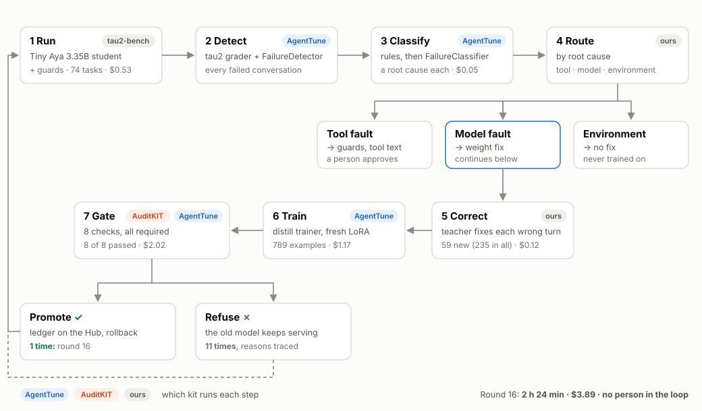

<div align="center">

# Shipwright

**A self-healing service for tool-calling agents.**
It finds the conversations its agent failed, works out why, applies the fix that matches the cause,
and redeploys only when a frozen gate measures the new agent as better on tasks it never trained on.

[](https://huggingface.co/mitushigoyal5/shipwright-lora)
[](https://huggingface.co/collections/mitushigoyal5/shipwright-self-healing-tiny-aya-datasets-6af95bf29994d1dfbba71cbb)
[](https://huggingface.co/spaces/mitushigoyal5/shipwright)


[What it does](#what-it-does) · [Results](#results) · [What makes it different](#what-makes-it-different) · [How it works](#how-it-works) · [Quickstart](#quickstart) · [Documentation](#documentation) · [Models and data](#models-and-data)

</div>

> [!IMPORTANT]
> **The loop promoted its first candidate with no person involved.** One command, one $4 cap, 2 h 24 min: the
> refused candidate ran the training tasks, its failures were classified, a teacher corrected each wrong turn, a new
> adapter trained, and it passed all 8 gate checks. Invented order ids **40 → 0**, tool-call errors **44% → 6%**,
> general tool calling (BFCL) **45 → 73**, task success **10% → 15%**, for **$0.015 per resolved ticket** on a 3.35B
> model. It is the deployed system today.

## What it does

The agent is **Tiny Aya Global** (3.35B) with a LoRA adapter, doing retail customer support on
[τ²-bench](https://github.com/sierra-research/tau2-bench): a simulated customer, a written policy, sixteen tools over
an order database, and a grader that checks the database, not the wording.

<picture>
  <source media="(prefers-color-scheme: dark)" srcset="submission/img/loop-dark.svg">
  
</picture>

Each round, unattended:

1. **Run** the deployed agent on the training tasks and log every turn, including the raw model output.
2. **Detect** failures: τ²-bench's grader plus AgentTune's `FailureDetector`.
3. **Classify** each failure: deterministic rules plus AgentTune's `FailureClassifier`, into one frozen label list.
4. **Route** by root cause: a tool fault goes to the **tool fix** (description patches in a ledger with rollback,
   policy guards on every tool call), a model fault to the **weight fix** (teacher replay and on-policy corrections,
   a LoRA trained with AgentTune), an environment fault to **no fix**.
5. **Gate** the candidate against the deployed system: 8 checks from AuditKIT and AgentTune, all required.
6. **Promote** to an append-only ledger with one-step rollback, or **refuse**, and let the failed checks pick the
   next remedy.

## Results

τ²-bench retail, 20 held-out tasks × 3 trials per system, the base model re-run in every gate:

| | Base Tiny Aya | **Shipwright (round 16)** | Teacher (DeepSeek V4.1 Flash) |
|---|---:|---:|---:|
| Task success, pass^1 | 10% | **15%** | 32% |
| Runs that invented an order or item id | 40 of 60 | **0** | |
| Early hand-offs to a human | 11 of 60 | **0** | |
| Tool-call error rate | 44% | **6%** | |
| BFCL v3, general tool calling | 45 | **73** | |
| Wasted tool calls (vs τ²'s expert path) | 69% | **21%** | 5% |
| Cost per resolved ticket | | **$0.015** | $0.037 (API) |

**On 20 hidden tasks**, opened once after every decision was made: task success **0% → 10%** (6 paired wins,
0 losses, exact McNemar p = 0.031), tool-call errors **56% → 5%** (round 7 adapter with guards).

Every number above is recomputed from the public run files, without a GPU or a token:

```sh
python scripts/reproduce.py        # 17 of 17 claims match the run files
```

The full analysis, every gate and every refusal: [`submission/WRITEUP.md`](submission/WRITEUP.md).

## What makes it different

- **It routes by cause.** Every failure is attributed to the tool interface, the model or the environment, and only
  the matching remedy runs. Copied example ids are fixed in the tool descriptions in minutes; wrong decisions go to
  the weights; simulator faults are never trained on.
- **The gate can say no, and did.** Eleven candidates were refused before one shipped, each for a reason traced in
  the conversations: forgetting general tool use, new failure kinds, context overflow. AgentTune's own
  `DeploymentGate` alone would have approved 10 of those 11. Missing evidence is a refusal, never an approval.
- **One command, no person in the loop.** `shipwright run --launch` runs every stage in one cloud execution, with
  per-stage and total spend caps checked before each stage starts, retries for transient faults, and resume after
  any crash. The controller that makes those decisions is pure and unit-tested on every path.
- **On-policy corrections.** The current candidate runs with policy guards on; every call a guard rejects becomes a
  point where the teacher shows the right next turn, and only that turn is trained.
- **Honest evaluation.** Three splits fixed by task id and enforced in code; frozen thresholds whose changes are logged
  with reasons; Wilson intervals, paired McNemar tests and a teacher ceiling for every claim; a hidden split opened
  once.
- **A small model that improves itself cheaply.** A round costs about $4; the healed 3.35B student resolves a ticket
  for 2.5× less than the teacher's API.

## How it works

| Layer | What it does | Where |
|---|---|---|
| Control | the `shipwright` CLI, a pure controller, the remedy recipe, spend caps, resume | `src/shipwright/loop/` |
| Healing | detect, classify, route, tool-patch ledger, gate, promotion ledger, AuditKIT metrics | `src/shipwright/heal/` |
| Serving harness | prompted tool calls, the 8k context budget, guards and repair, provider routing and retries | `src/shipwright/llm/` |
| Observability | JSON logs, failure reports, repro records, OpenTelemetry spans | `src/shipwright/observability/` |
| Control room | read-only replay of a round, task by task | `src/shipwright/control_room/` |
| Stages | one script per stage, each runnable alone | `scripts/` |
| Infrastructure | Cloud Run Jobs (CPU stages), HF Jobs (training and gate on vLLM), Cloud Build | `infra/` |

The architecture, decision points, deployment and failure handling are in the
[system design](docs/system-design.html).

## Quickstart

Requires Python 3.12 and git. Everything below is free and offline.

```sh
git clone <this repository> && cd Shipwright
./scripts/setup_tau2.sh                                                   # .venv with τ²-bench, AgentTune, AuditKIT, shipwright
.venv/bin/python -m pytest -q                                             # the test suite
.venv/bin/shipwright run --config configs/rounds/default.yaml --dry-run   # a whole round with fake models
.venv/bin/python scripts/reproduce.py                                     # check the published numbers
.venv/bin/streamlit run src/shipwright/control_room/app.py                # replay a round
```

Running for real needs a Hugging Face token with Jobs access, a GCP project with Vertex AI and Cloud Run, and a
spend approval:

```sh
.venv/bin/shipwright doctor                                               # preflight: tokens, configs, commands
.venv/bin/shipwright plan --config configs/rounds/<name>.yaml             # stages and worst-case spend
.venv/bin/shipwright run  --config configs/rounds/<name>.yaml --launch    # the unattended run
.venv/bin/shipwright show                                                 # what is deployed
```

## Documentation

| Topic | Document |
|---|---|
| Architecture and design | [docs/system-design.html](docs/system-design.html) |
| Evaluation protocol, splits, frozen values | [docs/evaluation.md](docs/evaluation.md) |
| The loop and round configs | [docs/pipeline/loop.md](docs/pipeline/loop.md) |
| The agent harness | [docs/pipeline/baseline.md](docs/pipeline/baseline.md) |
| Detect, classify, route | [docs/pipeline/classify.md](docs/pipeline/classify.md) |
| Tool fix: patches and guards | [docs/pipeline/tool_fix.md](docs/pipeline/tool_fix.md) |
| Weight fix: teacher data and training | [docs/pipeline/training.md](docs/pipeline/training.md) |
| Running the gate | [docs/pipeline/gate.md](docs/pipeline/gate.md) |
| Google Cloud, Hugging Face, Cloud Run | [docs/setup/](docs/setup/) |
| Debugging, observability, known issues | [docs/ops/](docs/ops/) |

## Models and data

| | Hugging Face | License |
|---|---|---|
| Deployed adapter | [`mitushigoyal5/shipwright-lora`](https://huggingface.co/mitushigoyal5/shipwright-lora), branch `round-16` (one branch per round) | CC-BY-NC-4.0 (from Tiny Aya) |
| Training data | [`mitushigoyal5/shipwright-sft`](https://huggingface.co/datasets/mitushigoyal5/shipwright-sft), branch per round | CC-BY-NC-4.0 |
| Every gate's runs and decisions, the promotion ledger | [`mitushigoyal5/shipwright-runs`](https://huggingface.co/datasets/mitushigoyal5/shipwright-runs) | CC-BY-NC-4.0 |
| Collections | [models](https://huggingface.co/collections/mitushigoyal5/shipwright-self-healing-tiny-aya-models-6af95bf1307f37a24ad807c6) · [data](https://huggingface.co/collections/mitushigoyal5/shipwright-self-healing-tiny-aya-datasets-6af95bf29994d1dfbba71cbb) | |

Student: [Tiny Aya Global](https://huggingface.co/CohereLabs/tiny-aya-global) (Cohere Labs, CC-BY-NC-4.0).
Teacher: DeepSeek V4.1 Flash on Vertex AI. Customer simulator and classifier: gpt-oss-120b. Benchmarks: τ²-bench
(MIT) and BFCL v3 (Apache-2.0). Tiny Aya's license is non-commercial: this work makes no commercial claim.

## Limitations

- 60 runs per system per gate: two tasks flipping move task success by 10 points, so single-gate gains are read with
  their intervals. The hidden split, the independent check, has been used once.
- Long lookup chains still overflow Tiny Aya's 8,192-token window; guards and compaction reduce it.
- The tool-fix proposer rewrites descriptions only; the guards that moved the numbers were written from the loop's
  traces.
- "Deployed" means promoted in the ledger that every later run serves; there is no live customer endpoint.

## Team

Built for the Lexsi Labs AI Safety and Alignment Hackathon, Track 3 (agentic fine-tuning), problem statement 8:
self-healing agents. Team: Tejas Nafde, Ishank Giri, Mitushi Goyal.
