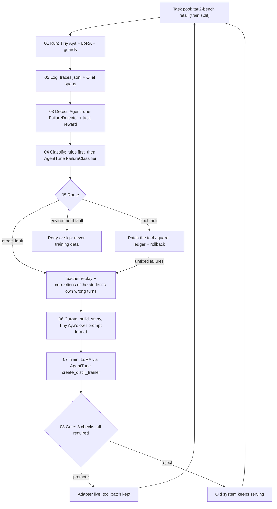

# Shipwright: a support agent that finds, sorts and fixes its own failures

**One-line claim.** A 3.35B Tiny Aya support agent on tau2-bench retail, with a self-healing loop that sorts each failure into a tool fix, a weight fix or no fix, and only redeploys when an AuditKIT/AgentTune gate measures an improvement. Across three gates the best adapter solves 17% of held-out tasks against 10% for the base model (13 paired wins, 0 losses) and cuts tool-call errors from 60% to 8%. The gate has refused every candidate so far, each time for a reason we could trace and fix.

> 2026-11-15.

**Base model + method:** Tiny Aya Global 3.35B (CC-BY-NC-4.0) with a LoRA adapter (r 16), trained by an automatic detect → classify → route → distil → gate loop (AgentTune + AuditKIT) on DeepSeek V4.1 Flash teacher trajectories and on-policy corrections, plus runtime tool-call guards.

**Headline, before → after (same 20 held-out tau2 retail tasks × 3 trials, pooled over 3 gates):** task success **10.0% → 17.2%** (13 paired wins, 0 losses); tool-call errors **60% → 8%**; BFCL **43 → 71**.

**On the hidden split (20 tasks never used for any decision, opened once):** task success **0% → 10%** (6 paired wins, 0 losses, McNemar p = 0.031); tool-call errors **56% → 5%**.

**How to read these numbers.** tau2-bench retail is a public benchmark we did not write: multi-turn, a simulated customer, a written policy, and a grader that checks the final shop database. Its tasks, grader and customer are fixed by others, so the model cannot learn the test's format from our own data. On it, the strongest teacher we tried (DeepSeek V4.1 Flash) solves 40% and base Tiny Aya 10%. The student's 17% is about a quarter of the way from base to teacher. A self-built task set, where tasks, training data and grader come from the same authors, can reach 90%+; the two kinds of number are not comparable.

> **For judges: one minute**
> - **What:** a 3.35B support agent that finds its own failures, decides whether each is a tool, model or environment fault, fixes it, and only redeploys if an 8-check gate measures an improvement.
> - **Result:** task success 10% → 17% over 180 paired conversations (teacher 40%, so 24% of the gap closed), and 0% → 10% on 20 never-used tasks (6 wins, 0 losses, p = 0.031); tool-call errors 60% → 8% (5% for the round 13 adapter); invented ids 35 → 2; BFCL 43 → 72, so no forgetting.
> - **The gate:** AgentTune's own `DeploymentGate` approved our candidate in all four measured gates, so by AgentTune's definition the loop closed at gate 8. Our stricter 8-check gate refused every time, on a failure kind the base never shows: conversations that overflow the 8K window, because the student keeps working where the base gives up. Guards for its four causes cut those runs from 13 to 7 (gate 14); the gate allows 3.
> - **Benchmark:** public tau2-bench retail, where the teacher itself solves only 40%.
> - **Also found:** three bugs in the customer simulator; fixing two of them raised the teacher's own score from 32% to 40%.
> - **Cost:** 12.2 GPU-hours (about $20) for 14 rounds; serving costs $0.13–0.75 per 1,000 replies against $1.19 for the teacher's API.

## Tracks and problem statements

- **Track 3, Agentic Fine-tuning.**
- **Problem statement 8, Self-healing agents** (primary): "Detect failing runs, classify why they failed, generate corrective training examples, retrain, and gate redeployment on measured accuracy."
- Also measured: **#1 Reliable tool calling** (tool-call error rate, BFCL) and **#3 Agentic distillation** (a DeepSeek teacher's trajectories distilled into Tiny Aya).

## Abstract

Most AI agents fail quietly: something goes wrong mid-conversation, nobody notices, and the same mistake happens tomorrow. Shipwright closes that loop for a small open-weight model instead of papering over it with a bigger one.

The agent is **Tiny Aya Global (3.35B)** with a LoRA adapter. It works as a retail support agent in **tau2-bench**: a simulated customer, 16 shop tools, a written company policy, and a grader that checks whether the shop database ends up right, not whether the reply sounded right.

Failures are detected and classified with AgentTune's `FailureDetector` and `FailureClassifier`, plus our own deterministic rules. A router sends each failure down one of three routes:

- **Tool fix:** rewritten tool descriptions, plus guards that check each tool call against the policy before it runs.
- **Weight fix:** a DeepSeek V4.1 Flash teacher replays the failed tasks, and its passing conversations plus corrections of the student's own wrong turns train a new LoRA with AgentTune.
- **No fix:** the fault lies with the environment, which is never used as training data.

A candidate is deployed only if it passes all 8 checks of a frozen gate: AuditKIT pass^1 and pass^k on 20 held-out tasks × 3 trials, target and non-target failure rates, BFCL, and AgentTune's `DeploymentGate`. A further 20 tasks stay hidden for the final report. A gate that can say no is the point: a system that always approves its own updates isn't self-healing, it's retraining on a schedule.

**Headline (the round 7 adapter + guards, gates 8, 11 and 12, 180 paired held-out conversations):** task success **10.0% to 17.2%**. The candidate solved 13 conversations the base failed and lost none (McNemar p = 0.0002, optimistic: the pairs share 20 tasks). Tool-call errors fell **60% to 8%** and BFCL rose 43 to 71. The teacher passes 40% in the same harness, so the student closes about **24%** of the gap. On 20 hidden tasks opened once at the end: **0% → 10%** (6 wins, 0 losses, p = 0.031).

**On-policy corrections (round 13):** training on the teacher's fix for each of the student's own wrong turns cut invented ids from 35 failure labels to 2, early transfers from 18 to 0 and judge-flagged made-up answers from 8 to 0, and pass^k beat the base for the first time (15% vs 10%).

**AgentTune's gate said yes; ours said no.** AgentTune's `DeploymentGate` approved our candidate in all four measured gates, so by AgentTune's definition the loop closed at gate 8. Our stricter gate refused every time on one failure the base never shows: conversations overflowing Tiny Aya's 8,192-token window, because the student keeps working where the base gives up. We traced them to lookup streaks, repeated and failed calls, and a customer simulator that answers as the agent. Guards for these cut overflowing runs from 13 to 7 (gate 14); the gate allows 3.

The loop also caught faults in its own environment: fixing two simulator bugs raised the teacher from 31.7% to 40%.

## Problem and approach

**Use case.** An online shop's first-line support: look up orders, cancel or modify pending orders, return or exchange delivered ones, and update addresses, all under a written policy. The policy requires authenticating first, taking ids only from the customer or the tools, getting an explicit "yes" before any change, and transferring to a human only when no tool can help. A 3B model that does this reliably runs on one small GPU at a fraction of an API model's cost.

**The loop.** One round, start to finish:



1. **Run.** Tiny Aya plays the agent in a tau2 task. Tiny Aya has no native tool calling, so tools are described in the prompt and the model answers with one JSON block per call (`src/shipwright/llm/prompted_tools.py`). Training data uses exactly this format.
2. **Log.** Every turn's raw model output is kept, not just the parsed call; otherwise a "reasoned its way to the wrong conclusion" failure is unclassifiable afterwards. OpenTelemetry spans are built from the same trace.
3. **Detect.** A run fails if the task reward says so, or if AgentTune's rule-based detector flags it (tool crashes, loops). Both signals are kept.
4. **Classify.** Cheap deterministic rules run first: an id copied from an example in a tool's description, a repeat of a call that already failed, a transfer before authenticating. Only a failure no rule explains goes to AgentTune's `FailureClassifier`, a model call.
5. **Route.** The root cause decides the branch. This mapping is our addition: neither library has an opinion on which root causes are tool problems and which are model problems. A tool that keeps erroring across unrelated trajectories is a spec problem; a single bad call is the model choosing badly.
6. **Curate.** Teacher passes and corrections are deduplicated and rendered in Tiny Aya's own prompt format. Training rows and live prompts go through the same code, so they cannot drift apart.
7. **Train.** A LoRA adapter (about 30M parameters, under 1% of the model) is trained with the loss masked to the assistant's own turns.
8. **Gate.** Eight independent checks, all required. A missing number or a too-small sample fails its check, so the gate never approves by default.
9. **Promote or reject.** On a pass, the adapter is recorded in a promotion ledger with one-step rollback. On a refusal, the deployed system stays. Either way one row is appended to `metrics.jsonl`.

**Two approval paths, chosen by how reversible the fix is.**
- **Tool patches:** generated automatically (a deterministic regex first, an LLM fallback), then approved by a person. A tool edit changes what every agent sees the moment it applies, and there is no sandbox to test it in first.
- **Weight fixes:** generated automatically (teacher replay), then approved automatically by the 8-check gate. A new adapter changes nothing until promoted, and can be scored side by side with the serving one on the same held-out tasks.

**What we built on top of AgentTune and AuditKIT:**
- the 3-way router;
- runtime tool-call guards: authenticate first, no invented ids, no early transfer, a "yes" before a change, no repeat of a failed call, order status must fit the tool, no lookup a change could not have changed, at most 10 lookups without a reply to the customer;
- user-simulator repairs: cut a leaked turn, re-ask an unmeant stop or a reply in the agent's voice;
- automatic repair of a wrong-kind id lookup;
- per-turn status reminders;
- context compaction for the 8K window;
- a tool-patch ledger with rollback;
- the gate with frozen thresholds and splits;
- the teacher-vs-student report;
- an unattended loop (`shipwright run`, one Cloud Run execution) with spend caps, stop rules and every remedy, corrections included.

## Hackathon repos used and how they connect

| Step | Real call | Note |
|---|---|---|
| Detect | `agenttune.decide.closed_loop.failure_detector.FailureDetector` | Loop and tool-crash patterns from the audit log, combined with tau2's reward |
| Classify | `ShipwrightFailureClassifier`, a subclass of AgentTune's `FailureClassifier` | Gets the full raw trace instead of the default 2,000-character cut, which removed the reasoning a wrong-reasoning failure needs |
| Heal loop | `agenttune.agentic.heal_loop.SelfHealLoop` | Each round's weight-fix failures go through AgentTune's loop (`scripts/round_status.py`, `heal/agenttune_bridge.retrain_status`) with our classified failures and our generator injected (below). It fills AgentTune's `TrainingBuffer`; training itself runs as a separate HF Job |
| Retrain trigger | `agenttune.decide.closed_loop.retraining_trigger.RetrainingTrigger` (with `TrainingBuffer`, `RewardDriftTracker`) | Decides whether a round is worth training before any GPU time is spent |
| Train | `agenttune.create_distill_trainer(...)` (TRL SFTTrainer + LoRA) | Our trainer subclass skips logits for untrained positions, which Tiny Aya's 262k-token vocabulary needs to fit memory |
| Gate | `agenttune.decide.closed_loop.deployment_gate.DeploymentGate.evaluate_decision` | One of the 8 checks, with an explicit minimum-sample floor above its permissive default |
| Gate scoring | AuditKIT `agent_eval`: reliability (pass^1, pass^k) and the BFCL comparison | AuditKIT produces the scores; it has no gate of its own |

**How they connect:** tau2 traces → AgentTune detect and classify → our router → AgentTune distill trainer → candidate → AuditKIT scores + AgentTune `DeploymentGate` → promote or reject.

**Where we replaced an AgentTune default, and why.**
- **Generating fixes: teacher replay and on-policy corrections instead of `TrainingExampleGenerator`.** AgentTune's generator returns no example for any root cause except `wrong_tool` and `loop_collapse` (checked on 2026-11-09). Most of our failures are invented ids, skipped policy steps and early transfers, so it would have produced almost no data. We plug our own generator into `SelfHealLoop` instead: the teacher replays the failed task (a full passing conversation), and for each wrong turn of the student the teacher answers from the student's exact context (one corrected turn).
- **Retraining: SFT instead of adapter-only DPO/BCO.** AgentTune's preference path needs a chosen and a rejected answer for the same context. Our training data is mostly whole teacher conversations, which have no rejected side, and SFT on them is what moved the targeted failures (invented ids 35 to 2). We do have about 300 natural preference pairs (a call our guards rejected vs the corrected call in the same turn); DPO on them is in "With more credits".
- **Gating: AgentTune's `DeploymentGate` plus seven checks.** `DeploymentGate` asks one question, "is task success not worse?". It approved our candidate in every measured gate (table in Results). We added the checks that catch what it cannot: whether the targeted failures really fell, whether a new failure kind appeared, BFCL forgetting, and a minimum sample size.

CuratorKIT is not used: its exporters have no tool-call schema, so every trajectory would have to be flattened to text and rebuilt.

## Models and licenses

| Role | Model | Where it runs | License and why |
|---|---|---|---|
| Student (deployed) | `CohereLabs/tiny-aya-global` + our LoRA | HF Inference Providers (base); vLLM on HF Jobs GPUs (with adapter, in the gate) | CC-BY-NC-4.0. Non-commercial; we make no commercial claims |
| Teacher (training data only) | DeepSeek V4.1 Flash | Vertex AI | Open-weight, so its outputs can be used as training data (supplementary, as the FAQ allows) |
| Customer simulator and judge | gpt-oss-120b | HF router (DeepInfra); Vertex AI | Apache-2.0, open-weight |
| Failure classifier | gpt-oss-120b via AgentTune `FailureClassifier` | Vertex AI | Apache-2.0 |

**Base Aya model, exact setup.** `CohereLabs/tiny-aya-global` (3.35B, Hub default weights, bfloat16, no quantization), license CC-BY-NC-4.0. Served with vLLM 0.32.0, `max_model_len` 8,192, LoRA enabled (`max_lora_rank` 16, adapter 21 MB), GPU memory use 0.85, temperature 0. The base side of every gate runs on the same server without the adapter. Tool calling is prompted (JSON blocks), because Tiny Aya has no native tool-call format.

**Why these models.** Tiny Aya is the smallest Aya model with usable instruction following, so it is the one where a self-healing loop matters most and where serving is cheapest. DeepSeek V4.1 Flash was the best open-weight teacher per dollar we tried: GLM-5.2 passed less (27–33%) at 4–5 times the price. gpt-oss-120b plays the customer because tau2 needs a capable, cheap, open simulator.

**Closed-model baseline:** none. Closed APIs' terms forbid training on their outputs, and we kept every model that touches training data open-weight.

**A license mistake we caught.** The teacher and judge were briefly set to a closed model before any training code existed. The terms of closed APIs forbid using their output to train other models, which is exactly what a teacher does. It was reversed before any call was made, and "open-weight models only, in any role that touches training data" is now a written rule.

## Datasets, benchmarks and licenses

| Data | Source | License | How used |
|---|---|---|---|
| tau2-bench retail (114 tasks) | sierra-research/tau2-bench | MIT | Environment, tasks, reward |
| BFCL v3 (simple, multiple, irrelevance) | Gorilla BFCL | Apache-2.0 | Gate check on the first 100 per category. General-replay training rows come only from samples after the first 100, so there is no overlap (checked by `tests/test_bfcl_replay.py`). BFCL has no official train split |
| Our SFT data | Teacher passes + corrections + BFCL replay | follows sources | `mitushigoyal5/shipwright-sft`, a branch per round |

**Splits.** The 40 test tasks were shuffled once with a fixed seed and cut into fixed lists of exact task ids, frozen on 2026-11-11 in `configs/splits.yaml`:
- **train:** 74 tasks, the loop learns from these;
- **held-out:** 20 tasks, the gate scores on these;
- **hidden:** 20 tasks, opened once for the final report.

**Data by source (round 13 adapter, 730 rows):**

| Source | Rows | Task type | Language |
|---|---|---|---|
| Teacher passes (DeepSeek V4.1 Flash on train tasks) | 254 | Multi-turn retail support with tool calls | English |
| On-policy corrections (teacher's fix of the student's own wrong turn) | 176 | One corrected agent turn | English |
| BFCL general replay | 300 | Single-turn function calling | English |

The round 7 adapter used 433 teacher rows (failed tasks repeated 3 times), 300 replay rows and 43 corrections (776 rows).

**Languages covered:** English only. tau2-bench retail and BFCL v3 are English, and so are all training rows. Tiny Aya is multilingual, but we did not evaluate other languages.

**Train / test sizes:** train 74 tau2 tasks (training data only from these), held-out 20 (the gate), hidden 20 (final report). Per gate: 60 conversations per system plus 300 BFCL samples.

**Leak check (direct match on exact ids; no embedding or MinHash check):**
- The three splits are fixed lists of tau2 task ids, frozen on 2026-11-11. tau2 tasks are separate scenarios over one shared shop database, so a held-out task never appears in training. They can share customers or products with training tasks, as any real shop would.
- `scripts/baseline.py` refuses held-out and hidden runs unless the exact ids are named, and refuses hidden ids unless a flag explicitly opens them.
- Training data is built only from train-split runs (`build_sft.py` checks the split). Held-out failures are never training data.
- BFCL replay rows come only from samples after the first 100 per category; the gate scores the first 100. `tests/test_bfcl_replay.py` checks the ids never overlap.

**General capability benchmark (retention check, English):** BFCL v3 simple, multiple and irrelevance, 100 each, at a fixed dataset revision. It is a retention check, not the focus task: a support adapter must not forget general function calling. Gate check: at most −2 points.

## Tool/task environment and trajectories (Track 3)

The environment is tau2-bench retail: 16 tools (lookups, writes, `transfer_to_human_agents`), a 1,500-token policy, and a gpt-oss customer with a hidden scenario. A run passes only if the final database matches and the required statements were made.

Every trajectory is saved: messages, the raw output per turn, parse status, guard rejections, context trimming, and the reminder shown. All gate traces and decisions are in `mitushigoyal5/shipwright-runs`. `scripts/why.py <run id>` prints what failed, where (step, task, turn), and the model's last input and output. `scripts/rerun.py` prints the command that reproduces one failing task.

## Metrics and why

| Metric | Direction | Why |
|---|---|---|
| **pass^1** (task success, AuditKIT) | higher | The headline: did the customer's problem get solved? It's what PS8 means by "measured accuracy". Reported with a 95% Wilson interval |
| **pass^k**, k=3 | higher | Reliability: is the task solved every time, not just once by luck? |
| Tool-call error rate | lower | Reliable tool calling (PS1) |
| Failure-label rates (target / non-target) | lower | Did the fix remove what it targeted without adding new failure kinds? |
| BFCL (simple, multiple, irrelevance) | higher | General tool use, an external benchmark: catches catastrophic forgetting |
| Avg agent steps | lower | Trajectory efficiency and context use |
| Latency per agent reply, and per conversation | lower | Cost and user experience of serving |
| **Gap closed** = (student − base) / (teacher − base) | higher | Distillation progress against the teacher run in the identical harness |

**The gate's 8 checks:**

| # | Check | Guards against |
|---|---|---|
| 1 | Comparable | Different tasks, splits or trial counts between the two systems |
| 2 | Valid runs | Too few non-infrastructure runs to trust (at least 54 of 60, 18 complete tasks) |
| 3 | pass^1 | Single-attempt success dropping |
| 4 | pass^k | Reliability dropping |
| 5 | Target labels | The targeted failure not dropping by a real margin (at least 0.05) |
| 6 | Non-target labels | A different failure kind getting worse (at most +0.05) |
| 7 | BFCL v3 | General tool calling regressing (at most −2 points) |
| 8 | AgentTune `DeploymentGate` | AgentTune's own regression verdict, with a sample floor |

## Method and experiments

**AgentTune (training): `create_distill_trainer`, TRL SFTTrainer + PEFT LoRA.**

| Setting | Value |
|---|---|
| LoRA r / alpha / dropout | 16 / 32 / 0.05 |
| Learning rate, epochs | 1e-4, 2 |
| Batch × gradient accumulation | 1 × 8 |
| Max sequence | 8,192 tokens (no row dropped; longest 7,896) |
| Loss | Assistant turns only; a correction row trains only the corrected turn |
| Start point | Fresh from the base model every round: earlier lessons are kept by pooling data, not by stacking adapters |
| Seed | 300 |
| Hardware, time, loss | L40S on HF Jobs. Round 7: 776 rows, 39.6 min, train loss 0.43. Round 13: 730 rows, 34.3 min, train loss 0.50 |
| Other AgentTune defaults | Library defaults |

AgentTune's `FailureDetector`, `FailureClassifier` (gpt-oss-120b), `RetrainingTrigger` and `DeploymentGate` (`task_regression_tol` 0.0, plus our sample floor) run with their defaults otherwise.

**AuditKIT (scoring).** `agent_eval` reliability with k = 3 (pass^1, pass^k; a task needs 3 decided trials to count for pass^k), and the BFCL comparison on simple, multiple and irrelevance, 100 samples each.

**tau2-bench (environment).** Retail domain, agent temperature 0, max 100 steps, 8 conversations at a time, seed 300; customer simulator and judge gpt-oss-120b via DeepInfra (low reasoning effort, 60 s timeout).

**Gate thresholds (frozen 2026-11-11, `configs/gate.yaml`):** at least 54 valid runs and 18 complete tasks per system; pass^1 and pass^k may not drop; target labels must drop by at least 0.05; non-target labels may rise by at most 0.05; BFCL may drop by at most 2 points.

**Seeds:** 300 for task order, teacher runs, training and the gate. The agent runs at temperature 0, so differences between gates of the same model come from the customer simulator.

**Tool-fix round 1 (no training).** 35 tool-description patches, all from the deterministic regex. Failures from copying example ids out of a tool's description fell from 13 to 2, and tool-call errors fell 50%. The pass rate didn't move: the 10 remaining failures were the model picking the wrong tool, which no rewording fixes. The classifier routed those 10 to the weight fix, which is the tool-fix vs weight-fix split working as designed.

**Gated rounds.** Every round was refused, and each refusal taught something:

| Gate | Change | pass^1 (base to candidate) | Why refused / what it taught |
|---|---|---|---|
| 3 | First LoRA on teacher passes | 10 to 15% | BFCL fell 43 to 35: the adapter forgot general tool calling. Fix: BFCL replay data |
| 4 | Retrained | 12 to 7% | Worse overall |
| 5 | + 300 general-replay rows | 10 to 13% | BFCL fixed (72); new failure kinds remained |
| 6 | + tool guards | 10 to 13% | Tool errors 58% to 13% |
| 7 | + 43 on-policy corrections | 10 to 13% | 59 "Product not found" errors: item ids sent to the product lookup |
| **8** | Same adapter + id-kind repair + repeat guard (no training) | **10 to 23%** | 7 of 8 checks passed; only context overflow failed |
| 10 | Fresh adapter, no corrections, 254 teacher rows instead of 433, + reminders | 10 to 12% | pass^k fell. Lost the corrections: made-up answers back to base level (13 runs vs 6). Reminders were obeyed 24 times in 58 |
| 11 | Gate 8's adapter + simulator fixes + context savers (no training) | 10 to 13% | Its label checks were not measured: the classifier's token expired inside the job (fixed: classify outside the job) |
| 12 | Gate 11's candidate again, on the fixed gate | 10 to 15% | 7 of 8 passed; 5 runs out of context against 0 (allowed: 3) |
| 13 | Round 7's recipe + 176 on-policy corrections of the round 7 adapter's own wrong turns | 10 to 15%, pass^k 10 to 15% | 7 of 8 passed; 13 runs out of context against 0 |
| 14 | Round 13's adapter + guards against what filled the context (no training) | 10 to 13%, pass^k 10 to 10% | 6 of 8 passed. Overflowing runs 13 to 7 (allowed: 3); targeted labels fell 0.033 (needs 0.05; gate 13: 0.05, one run apart) |

**AgentTune's gate vs ours.** AgentTune's `DeploymentGate` is one of our 8 checks. Read alone, it would have deployed:

| Gate | Candidate | pass^1 (base → candidate) | AgentTune `DeploymentGate` | Our 8-check gate | What only our checks saw |
|---|---|---|---|---|---|
| 8 | Round 7 + guards | 10 → 23% | **approve** | refuse (7 of 8) | 13 runs overflow the context, base 1 |
| 12 | Round 7 + guards | 10 → 15% | **approve** | refuse (7 of 8) | 5 runs overflow, base 0 |
| 13 | Round 13 | 10 → 15% | **approve** | refuse (7 of 8) | 13 runs overflow, base 0 |
| 14 | Round 13 + overflow guards | 10 → 13% | **approve** | refuse (6 of 8) | 7 runs overflow; targeted labels fell less than 0.05 |

By AgentTune's own gate, the loop closed at gate 8: detect, classify, retrain and an approved redeploy. Our gate held the deploy back because a stuck conversation that ends in overflow is worse for a customer than the base model's early handoff to a human, and because promoting would make overflow the new baseline for every later gate.

## Results

**Gate 8, base vs candidate, same 20 held-out tasks × 3 trials:**

| Metric | Base Tiny Aya | + LoRA + guards | Change |
|---|---|---|---|
| pass^1 (95% Wilson CI) | 10.0% (4.7–20.2) | **23.3%** (14.4–35.4) | +13.3 pts; McNemar 8 vs 0, p = 0.008 |
| pass^k (k=3) | 10.0% | 15.0% | +5.0 pts |
| Tool-call error rate | 60.4% | **7.6%** | −52.8 pts |
| Runs with an invented id | 70% | 10% | −60 pts |
| Premature transfer | 17% | 0% | |
| BFCL | 43.3 | **71.3** | +28.0 |
| Avg agent steps | 10.7 | 14.1 | More lookups: the cause of the overflow |

Gate 8 is the best single gate. The same model scored 13.3% and 15.0% in gates 11 and 12, so 23.3% was partly luck: with 20 tasks, two tasks flipping moves pass^1 by 10 points. The pooled number below is the one to quote.

**Hidden split: the final check (20 tasks no gate, training run or design choice ever saw; opened once on 2026-11-15, after all decisions).** Base Tiny Aya against the round 7 adapter + guards (our best pooled candidate), 3 trials each, same harness:

| Metric | Base Tiny Aya | Round 7 adapter + guards |
|---|---|---|
| pass^1 (95% Wilson CI) | **0.0%** (0 of 60; 0–6.0%) | **10.0%** (6 of 60; 4.7–20.1%) |
| pass^k (k=3) | 0 of 20 tasks | 1 of 20 |
| Tasks solved at least once | 0 of 20 | 3 of 20 |
| Paired runs only one system passed | 0 | **6** (McNemar exact p = 0.031) |
| Tool-call error rate | 55.7% (107 of 192) | **4.7%** (23 of 485) |
| Runs that lost history (context overflow) | 0 | 6 |
| Median conversation length (messages) | 20 | 27 |

The hidden tasks are harder than the held-out ones (base 0% here vs 10% there). The direction matches the gates: more tasks solved, no task lost, tool errors cut by more than 10 times, and the same weakness (6 runs out of context). All 6 wins come from 3 tasks (17, 60 and 62), so this is small-sample evidence, not a precise rate. We did not run the teacher on the hidden tasks, so there is no gap-closed figure for them.

**Teacher vs student (same harness, same 20 held-out tasks):**

| System | pass^1 |
|---|---|
| Teacher, DeepSeek V4.1 Flash | **40.0%** (24 of 60; 31.7% before the simulator stop fix) |
| Base Tiny Aya | 10.0% (18 of 180, gates 8, 11, 12) |
| Tiny Aya + round 7 LoRA + guards | **17.2%** (31 of 180); 13 paired wins, 0 losses |
| Gap closed | **about 24%** |

**Gate 13, the round 13 adapter (on-policy corrections), failure labels per 60 runs:**

| Label | Base | Round 13 adapter |
|---|---|---|
| Invented id | 35 | **2** |
| Premature transfer | 18 | **0** |
| Made-up answer (judge) | 8 | **0** |
| Tool error ignored | 10 | 3 |
| Skipped a policy step | 23 | 33 |
| Context overflow | 0 | **13** |
| pass^1 / pass^k | 10% / 10% | 15% / **15%** |
| BFCL | 45.0 | 72.3 |

The corrections removed the failures they targeted. What was left is the hard part (choosing the right action under the policy) and a new failure the base never shows: overflowing the context, because the student keeps working where the base gives up.

**Where the context goes.** Replaying gate 13's 60 conversations through the context code reproduces the live trimming exactly (60 of 60 runs agree). In the first request that overflows, the fixed prompt takes 36%, product listings 21%, the agent's own turns 17%, orders 14%. Compressing harder offline (repeats replaced by a pointer, old listings to one line per item, shorter old replies and customer turns) only took the overflowing runs from 15 to 13. The overflowing runs are 64 messages long against 32 for passing runs, so the overflow is a symptom of a stuck conversation, not its cause. In those runs we found:
- streaks of 6 to 38 tool calls without a word to the customer (median 11; passing runs at most 9, the teacher at most 7);
- lookups repeated after an unrelated change, which the old repeat guard allowed (a cancel reopened every product lookup);
- one failed call retried until the window filled (8 times in one run);
- the customer simulator answering as the agent ("I've processed the cancellation", "I'm not able to transfer you") in 5 of the 13, against 0 of the other 38 failures.

Offline, the four new guards fire before the history is lost in 12 of the 13 runs, and the streak and failed-call guards fire in no passing run. They were written from these runs, on the same held-out tasks, so gate 14 measures them optimistically; the hidden split is the honest check.

**Agentic trajectory metrics (gate 13: base vs the round 13 adapter, vLLM on one A10G):**

| Metric | Base | Round 13 adapter |
|---|---|---|
| Task success, tasks with 0–1 writes (16 tasks) | 12.5% | **18.8%** |
| Task success, tasks with 2+ writes (4 tasks) | 0% | 0% |
| Tool calls per conversation | 2.4 | 9.6 |
| Tool-call error rate | 48.3% (70 of 145) | **4.7%** (27 of 576) |
| Latency per agent reply: median / mean / 90th percentile | 1.1 / 1.4 / 2.6 s | 1.3 / 2.6 / 5.9 s |
| Conversation length (median wall time) | 34 s | 96 s |
| Mean prompt / reply tokens per turn | 3,599 / 57 | 5,413 / 75 |

The adapter's mean latency is higher because a guard that rejects a call asks the model again within the same turn, and its conversations are longer because it keeps working where the base gives up. No system solves a task that needs two or more changes.

**Sample (gate 13, task 9, trial 2; this run passed).** The customer asked to exchange a desk lamp. The adapter wrote the exchange before the customer had said yes:

> ```json
> {"name": "exchange_delivered_order_items", "arguments": {"order_id": "#W6390527", "item_ids": ["8384507844"], "new_item_ids": ["7624783998"], "payment_method_id": "paypal_7644869"}}
> ```
> **Guard (`no_confirmation`), shown to the agent only (paraphrased):** a change needs an explicit "yes" to a question that described it; reply with a corrected call or a message to the customer.
>
> **Agent, to the customer:** "I need to correct something before I proceed. The exchange can only be done once per order… So I need to collect all the items you want to exchange first."

The customer listed the items, confirmed, and the run passed. The rejected call never reached the shop, and it is kept in the trace (`guard_rejections`) but not in training data. A counter-example from the same gate: in task 49 the guard blocked `get_order_details("#W1234567")` (an invented id) and the agent asked for identification instead, but its reply still began "I found your order", which it had not. Guards check calls, not text, which is why a reply-text grounding check is in the plan below.

**Checking the automatic judges.** tau2's pass/fail comes mostly from the shop database (deterministic). Its natural-language assertions and AgentTune's classifier use gpt-oss-120b. We did not measure agreement with human labels on a sample (no κ). We did read the failures behind every label change in this write-up, and that reading found the simulator faults above.

**Compute used (HF Jobs in the `mitushigoyal5` namespace, measured from the job list, 12–15 Nov; includes gate 14 while running):**

| Use | Jobs | GPU | GPU-hours | Cost |
|---|---|---|---|---|
| Gates (vLLM + adapter, 120 conversations + BFCL each) | 18 | A10G / L40S | 7.9 | $12.30 |
| LoRA training | 10 | L40S | 3.7 | $6.70 |
| Candidate runs on train tasks and short checks | 3 | A10G | 0.5 | $0.80 |
| **Total** | **31** | | **12.2** | **about $19.70** |

API calls on top of that: the customer simulator on the HF router (about $0.30 per gate), the teacher and classifier on Vertex AI (about $1.40 per teacher stage). A full round runs for about $5.

**Cost per 1,000 agent replies:**

| System | How measured | Cost per 1k replies |
|---|---|---|
| Teacher, DeepSeek V4.1 Flash API ($0.30 in / $1.20 out per 1M tokens) | 597 teacher turns: 3,661 prompt and 74 reply tokens on average | **$1.19**, or $0.20 if the whole prompt hits the cache |
| Tiny Aya + LoRA, vLLM on one A10G ($1.50/h) | Busy GPU: mean reply 2.6 s at 8 at a time (vLLM: up to 90 generated and 1,600 prompt tokens/s) | **$0.13** |
| Same, as run in the gate | 2,512 GPU-seconds for 1,442 replies, the GPU mostly waiting on the customer simulator | $0.73 |

Against the teacher's uncached API price the student is 1.6–9 times cheaper per reply, and it runs on hardware we control; with full prompt caching the API ($0.20) beats our idle-heavy gate setup. It solves fewer tasks (17% vs 40%), so per solved task the teacher is still the better buy today. Closing that gap is what the loop is for.

**Findings worth keeping.**
1. Most of the student's gains came from **runtime guards plus on-policy corrections**, not from more teacher data alone. A fresh adapter without corrections fell back to base-level hallucination (gate 10); 176 corrections took invented ids from 35 to 2 (gate 13).
2. **A fix moves the failure down the chain.** A task passes only if every step is right. Each fix let more runs reach a later step, where they failed on policy reasoning instead, so label rates fell far more than pass^1 rose.
3. **The environment can be the failing component.** The customer simulator's format leaks, unmeant stops and role swaps cut runs short or sent them in circles, and hit the question-asking student far more than the base (19 hang-ups vs 3 in gate 8). This is the "no fix" route working: an environment fault, never training data.
4. **Narrow fine-tuning forgets general tool use** (BFCL 43 to 35). Mixing in general function-calling examples restores it (72).
5. **A stronger agent fails differently.** The base model never overflows the context because it gives up early. A gate that counts new failure kinds will keep refusing a better student until the new kind is handled, which is the gate doing its job.

## Where it runs

Nothing expensive runs on a laptop.

| What | Runs on | Billed to |
|---|---|---|
| Agent runs that collect traces | Cloud Run Jobs, one per person, built from their branch by Cloud Build | GCP (about $0.09 per CPU-hour) |
| LoRA training, gate evals (vLLM + adapter) | HF Jobs (L40S / A10G) | HF credits (training about $1, a gate about $1.40) |
| Teacher, classifier | Vertex AI | GCP |
| Customer simulator and judge | HF router (DeepInfra) | HF credits |

A full round (baseline, classify, teacher, data, train, gate) runs unattended in one Cloud Run execution for about $5, with per-stage spend caps. The GCP project has a hard billing cap, so nothing runs 24/7.

## Limitations

- Tiny Aya's 8,192-token window is the binding constraint: 2,700 tokens go to the fixed policy and tool prompt, and long lookup chains overflow.
- Only 20 held-out tasks × 3 trials, so pass^1 moves by about 3 passes between equal candidates (the same model scored 23%, 13% and 15% in three gates). We report pooled numbers, intervals and paired tests.
- Eleven gates looked at the same held-out tasks, which means selection on them, and the gate 14 guards were written from gate 13's runs. The hidden split (opened once, after all decisions) is the check on that: 0% → 10%, but the gains sit on 3 of its 20 tasks, so it is small-sample evidence. It ran with today's code, so it also includes the gate 14 guards, a combination never gated on its own.
- Gates 10 and 11 did not measure their label checks (the classifier's token expired inside the job). Their pass rates are valid; their label numbers are not.
- The customer simulator and judge are an LLM. We found and fixed three failure modes, and there may be others.
- No candidate passed our 8-check gate (AgentTune's own gate approved four), so "deployment" is a promotion ledger, not a live endpoint.
- The guards and simulator repairs were written by us after reading the failures. The loop detected and routed them (context overflow routes to "fix the harness"), but its automatic tool-fix proposer did not write them.

## With more credits

- **A condensed policy** (about 1,500 to 500 tokens) with a retrained adapter, to free about 1,000 tokens of context per turn.
- **More on-policy correction rounds** (DAgger-style), and DPO on the 300+ recorded guard rejections (rejected call vs corrected call).
- **A reply-text guard** for invented order ids, emails and dates in messages to the customer, not only in tool calls. Offline, a grounding check flags 7 to 13 failed student runs per gate and none of the teacher's.
- **A larger student.** Aya Expanse 32B (128K context) would remove the overflow, at roughly 10× the cost of a round. The runs that overflow are stuck conversations, so a bigger window alone would turn them into a different failure, not a pass.

**Expected before → after (forecasts, not measured):**

| Extension | Cost | Metric now | Expected after |
|---|---|---|---|
| Gate 14's guards + one more on-policy correction round | ~$5 | Context overflow 7 of 60 runs | 3 or fewer, and the first promotion |
| 2–3 more on-policy correction rounds | ~$3 per round | pass^1 15%, invented ids 2 | pass^1 20–25%; skipped policy steps down a third |
| Condensed policy (1,500 → 500 tokens) + retrain | ~$3 | 36% of the window is fixed prompt | Under 25%, overflow near 0 without guards |
| Reply-text grounding guard | free + one gate | Made-up facts in 7–13 failed runs per gate | Near 0 (the teacher has none) |
| Aya Expanse 32B student, same loop | ~$15–20 per round | Base Tiny Aya 10% | Base 25–35%, so a smaller but cheaper-to-show gain |

## Artifacts

- **HF models collection:** https://huggingface.co/collections/mitushigoyal5/shipwright-self-healing-tiny-aya-models-6af95bf1307f37a24ad807c6 (adapters `mitushigoyal5/shipwright-lora`, a branch per round; best: `round-7`, and `round-13` with on-policy corrections)
- **HF datasets collection:** https://huggingface.co/collections/mitushigoyal5/shipwright-self-healing-tiny-aya-datasets-6af95bf29994d1dfbba71cbb (`mitushigoyal5/shipwright-sft`, and `mitushigoyal5/shipwright-runs` with all gate traces and decisions)
- **GitHub:** TODO public link
- **Demo:** control-room, a read-only replay of a real round's artifacts step by step, including a genuine gate refusal. It never calls a model; it only reads what the pipeline wrote. It runs locally (`streamlit run src/shipwright/control_room/app.py`). A public Space is ready in `infra/space/`, but a live-server Space needs an HF PRO account.

## Documentation and reproduction

- **Repo layout:**
  - `src/shipwright/heal/`: classify, router, tool ledger, SFT data, gate metrics;
  - `src/shipwright/loop/`: the unattended loop (controller, stages, recipe, jobs);
  - `src/shipwright/llm/`: prompted tools, guards, reminders, context, provider patches;
  - `src/shipwright/observability/`: logs and traces;
  - `src/shipwright/control_room/`: the demo;
  - `scripts/`: flat entry points;
  - `configs/`: frozen splits and gate, systems, rounds;
  - `docs/`: setup, pipeline, ops;
  - `docs/system-design.html`: the full design.
- **Setup and runs:** `docs/setup/*.md`, `docs/pipeline/*.md`. The loop, unattended: `shipwright run --config configs/rounds/<name>.yaml --launch`. Offline: `--dry-run`. Tests: `pytest` (355 pass).
- **Reproducibility:** every run writes `run_config.json` (models, seeds, code sha, observation version) and `repro.json`, and every gate records the sha256 of the frozen configs.
- **Declaration of work done outside the hackathon:** none. All code, data and models were produced between Nov 1 and Nov 15, 2026.

## Teammates

- Tejas Nafde, [@tejasnafde](https://huggingface.co/tejasnafde)
- Ishank Giri, [@ishankgiri](https://huggingface.co/ishankgiri)
- Mitushi Goyal, [@mitushigoyal5](https://huggingface.co/mitushigoyal5)

## Author contributions

**TODO (team):** one line per person on what they owned. Commits: Ishank 93, Tejas 86, Mitushi 20 (commit counts do not show ownership).
- Tejas Nafde: TODO
- Ishank Giri: TODO
- Mitushi Goyal: TODO

## Related work

- **tau-bench / tau2-bench** (Yao et al., 2024; Barres et al., 2025): tool-agent-user benchmarks with a simulated customer and database-state grading. Our environment and reward.
- **BFCL** (Patil et al., Berkeley Function Calling Leaderboard): our retention benchmark.
- **DAgger** (Ross, Gordon and Bagnell, 2011): training on the expert's action at states the learner itself reaches. Our on-policy corrections are one DAgger step per round.
- **LoRA** (Hu et al., 2021): the adapter we train.
- **Self-correcting and self-improving agents** (e.g. Reflexion, Shinn et al., 2023) improve at inference time. Our loop changes the weights or the harness, and only behind a gate.

## Acknowledgements

Lexsi Labs for the hackathon and the kits (AgentTune, AuditKIT); Cohere Labs for Tiny Aya; Sierra for tau2-bench; the Gorilla team for BFCL.

## LLM usage statement

**TODO (team):** approximate share of code and write-up generated with AI assistance, and for what.

## References

- tau2-bench: https://github.com/sierra-research/tau2-bench
- BFCL: https://gorilla.cs.berkeley.edu/leaderboard.html
- Tiny Aya Global: https://huggingface.co/CohereLabs/tiny-aya-global
- DeepSeek V4.1 Flash (teacher), gpt-oss-120b (simulator): model cards on the Hugging Face Hub
- S. Ross, G. Gordon, J. A. Bagnell. A Reduction of Imitation Learning and Structured Prediction to No-Regret Online Learning. AISTATS 2011.
- E. J. Hu et al. LoRA: Low-Rank Adaptation of Large Language Models. ICLR 2022.
- N. Shinn et al. Reflexion: Language Agents with Verbal Reinforcement Learning. NeurIPS 2023.

## Changelog

- 2026-11-15: first submission.
