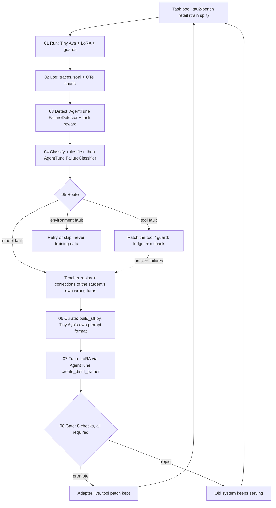

# Shipwright: a support agent that finds, sorts and fixes its own failures

**One-line claim.** A 3.35B Tiny Aya support agent on tau2-bench retail, with a self-healing loop that sorts each failure into a tool fix, a weight fix or no fix, and only redeploys when an AuditKIT/AgentTune gate measures an improvement. The best system more than doubles task success over the base model (10% to 23%) and cuts tool-call errors from 60% to 8%.

> DRAFT, 2026-11-14. Cells marked **PENDING** wait for gate 11 and the clean teacher ceiling, which are running now.

## Tracks and problem statements

- **Track 3, Agentic Fine-tuning.**
- **Problem statement 8, Self-healing agents** (primary): "Detect failing runs, classify why they failed, generate corrective training examples, retrain, and gate redeployment on measured accuracy."
- Also measured: **#1 Reliable tool calling** (tool-call error rate, BFCL) and **#3 Agentic distillation** (a DeepSeek teacher's trajectories distilled into Tiny Aya).

## Abstract

Most AI agents fail quietly: something goes wrong mid-conversation, nobody notices, and the same mistake happens tomorrow. Shipwright closes that loop for a small open-weight model instead of papering over it with a bigger one.

The agent is **Tiny Aya Global (3.35B)** with a LoRA adapter. It works as a retail support agent in **tau2-bench**: a simulated customer, 16 shop tools, a written company policy, and a grader that checks whether the shop database ends up right, not whether the reply sounded right.

Failures are detected and classified with AgentTune's `FailureDetector` and `FailureClassifier`, plus our own deterministic rules. A router sends each failure down one of three routes:

- **Tool fix:** rewritten tool descriptions, plus guards that check each tool call against the policy before it runs.
- **Weight fix:** a DeepSeek V4.1 Flash teacher replays the failed tasks, and its passing conversations plus corrections of the student's own wrong turns train a new LoRA with AgentTune.
- **No fix:** the fault lies with the environment, which is never used as training data.

A candidate is deployed only if it passes all 8 checks of a frozen gate: AuditKIT pass^1 and pass^k on 20 held-out tasks × 3 trials, target and non-target failure rates, BFCL, and AgentTune's `DeploymentGate`. A further 20 tasks stay hidden for the final report. A gate that can say no is the point: a system that always approves its own updates isn't self-healing, it's retraining on a schedule.

**Headline (gate 8, same 60 held-out conversations):** task success **10.0% to 23.3%** (paired McNemar 8 vs 0, p = 0.008), tool-call errors **60% to 8%**, runs with an invented id 70% to 10%, BFCL 43 to 71. The gate still refused this candidate on one check: longer conversations overflow Tiny Aya's 8,192-token window.

The loop also caught faults in its own environment. The gpt-oss customer simulator sometimes wrote past its turn, or sent the end-of-conversation signal while its reasoning said it meant to answer. That cut short the teacher and the polite, question-asking student far more than the base model. Both are fixed, and numbers re-measured with the fixes are **PENDING**.

## Problem and approach

**Use case.** An online shop's first-line support: look up orders, cancel or modify pending orders, return or exchange delivered ones, and update addresses, all under a written policy. The policy requires authenticating first, taking ids only from the customer or the tools, getting an explicit "yes" before any change, and transferring to a human only when no tool can help. A 3B model that does this reliably runs on one small GPU at a fraction of an API model's cost.

**The loop.** One round, start to finish:

1. **Run.** Tiny Aya plays the agent in a tau2 task. Tiny Aya has no native tool calling, so tools are described in the prompt and the model answers with one JSON block per call (`src/shipwright/llm/prompted_tools.py`). Training data uses exactly this format.
2. **Log.** Every turn's raw model output is kept, not just the parsed call; otherwise a "reasoned its way to the wrong conclusion" failure is unclassifiable afterwards. OpenTelemetry spans are built from the same trace.
3. **Detect.** A run fails if the task reward says so, or if AgentTune's rule-based detector flags it (tool crashes, loops). Both signals are kept.
4. **Classify.** Cheap deterministic rules run first: an id copied from an example in a tool's description, a repeat of a call that already failed, a transfer before authenticating. Only a failure no rule explains goes to AgentTune's `FailureClassifier`, a model call.
5. **Route.** The root cause decides the branch. This mapping is our addition: neither library has an opinion on which root causes are tool problems and which are model problems. A tool that keeps erroring across unrelated trajectories is a spec problem; a single bad call is the model choosing badly.
6. **Curate.** Teacher passes and corrections are deduplicated and rendered in Tiny Aya's own prompt format. Training rows and live prompts go through the same code, so they cannot drift apart.
7. **Train.** A LoRA adapter (about 30M parameters, under 1% of the model) is trained with the loss masked to the assistant's own turns.
8. **Gate.** Eight independent checks, all required. A missing number or a too-small sample fails its check, so the gate never approves by default.
9. **Promote or reject.** On a pass, the adapter is recorded in a promotion ledger with one-step rollback. On a refusal, the deployed system stays. Either way one row is appended to `metrics.jsonl`.

**Two approval paths, chosen by how reversible the fix is.**
- **Tool patches:** generated automatically (a deterministic regex first, an LLM fallback), then approved by a person. A tool edit changes what every agent sees the moment it applies, and there is no sandbox to test it in first.
- **Weight fixes:** generated automatically (teacher replay), then approved automatically by the 8-check gate. A new adapter changes nothing until promoted, and can be scored side by side with the serving one on the same held-out tasks.

**What we built on top of AgentTune and AuditKIT:**
- the 3-way router;
- runtime tool-call guards: authenticate first, no invented ids, no early transfer, a "yes" before a change, no repeat of a failed call, order status must fit the tool;
- automatic repair of a wrong-kind id lookup;
- per-turn status reminders;
- context compaction for the 8K window;
- a tool-patch ledger with rollback;
- the gate with frozen thresholds and splits;
- the teacher-vs-student report;
- an unattended loop (`shipwright run`, one Cloud Run execution) with spend caps, stop rules and every remedy, corrections included.

## Hackathon repos used and how they connect

| Step | Real call | Note |
|---|---|---|
| Detect | `agenttune.decide.closed_loop.failure_detector.FailureDetector` | Loop and tool-crash patterns from the audit log, combined with tau2's reward |
| Classify | `ShipwrightFailureClassifier`, a subclass of AgentTune's `FailureClassifier` | Gets the full raw trace instead of the default 2,000-character cut, which removed the reasoning a wrong-reasoning failure needs |
| Retrain trigger | `agenttune.decide.closed_loop.retraining_trigger.RetrainingTrigger` | Decides whether a round is worth training before any GPU time is spent |
| Train | `agenttune.create_distill_trainer(...)` (TRL SFTTrainer + LoRA) | Our trainer subclass skips logits for untrained positions, which Tiny Aya's 262k-token vocabulary needs to fit memory |
| Gate | `agenttune.decide.closed_loop.deployment_gate.DeploymentGate.evaluate_decision` | One of the 8 checks, with an explicit minimum-sample floor above its permissive default |
| Gate scoring | AuditKIT `agent_eval`: reliability (pass^1, pass^k) and the BFCL comparison | AuditKIT produces the scores; it has no gate of its own |

**How they connect:** tau2 traces → AgentTune detect and classify → our router → AgentTune distill trainer → candidate → AuditKIT scores + AgentTune `DeploymentGate` → promote or reject.

CuratorKIT is not used: its exporters have no tool-call schema, so every trajectory would have to be flattened to text and rebuilt.

## Models and licenses

| Role | Model | Where it runs | License and why |
|---|---|---|---|
| Student (deployed) | `CohereLabs/tiny-aya-global` + our LoRA | HF Inference Providers (base); vLLM on HF Jobs GPUs (with adapter, in the gate) | CC-BY-NC-4.0. Non-commercial; we make no commercial claims |
| Teacher (training data only) | DeepSeek V4.1 Flash | Vertex AI | Open-weight, so its outputs can be used as training data (supplementary, as the FAQ allows) |
| Customer simulator and judge | gpt-oss-120b | HF router (DeepInfra); Vertex AI | Apache-2.0, open-weight |
| Failure classifier | gpt-oss-120b via AgentTune `FailureClassifier` | Vertex AI | Apache-2.0 |

**A license mistake we caught.** The teacher and judge were briefly set to a closed model before any training code existed. The terms of closed APIs forbid using their output to train other models, which is exactly what a teacher does. It was reversed before any call was made, and "open-weight models only, in any role that touches training data" is now a written rule.

## Datasets, benchmarks and licenses

| Data | Source | License | How used |
|---|---|---|---|
| tau2-bench retail (114 tasks) | sierra-research/tau2-bench | MIT | Environment, tasks, reward |
| BFCL v3 (simple, multiple, irrelevance) | Gorilla BFCL | Apache-2.0 | Gate check on the first 100 per category. General-replay training rows come only from samples after the first 100, so there is no overlap (checked by `tests/test_bfcl_replay.py`). BFCL has no official train split |
| Our SFT data | Teacher passes + corrections + BFCL replay | follows sources | `mitushigoyal5/shipwright-sft`, a branch per round |

**Splits.** The 40 test tasks were shuffled once with a fixed seed and cut into fixed lists of exact task ids, frozen on 2026-11-11 in `configs/splits.yaml`:
- **train:** 74 tasks, the loop learns from these;
- **held-out:** 20 tasks, the gate scores on these;
- **hidden:** 20 tasks, opened once for the final report.

**Leak check.**
- `scripts/baseline.py` refuses held-out and hidden runs unless the exact ids are named, and refuses hidden ids unless a flag explicitly opens them.
- Training data is built only from train-split runs (`build_sft.py` checks the split).
- Held-out failures are never training data.

## Tool/task environment and trajectories (Track 3)

The environment is tau2-bench retail: 16 tools (lookups, writes, `transfer_to_human_agents`), a 1,500-token policy, and a gpt-oss customer with a hidden scenario. A run passes only if the final database matches and the required statements were made.

Every trajectory is saved: messages, the raw output per turn, parse status, guard rejections, context trimming, and the reminder shown. All gate traces and decisions are in `mitushigoyal5/shipwright-runs`. `scripts/why.py <run id>` prints what failed, where (step, task, turn), and the model's last input and output. `scripts/rerun.py` prints the command that reproduces one failing task.

## Metrics and why

| Metric | Direction | Why |
|---|---|---|
| **pass^1** (task success, AuditKIT) | higher | The headline: did the customer's problem get solved? It's what PS8 means by "measured accuracy". Reported with a 95% Wilson interval |
| **pass^k**, k=3 | higher | Reliability: is the task solved every time, not just once by luck? |
| Tool-call error rate | lower | Reliable tool calling (PS1) |
| Failure-label rates (target / non-target) | lower | Did the fix remove what it targeted without adding new failure kinds? |
| BFCL (simple, multiple, irrelevance) | higher | General tool use, an external benchmark: catches catastrophic forgetting |
| Avg agent steps | lower | Trajectory efficiency and context use |
| **Gap closed** = (student − base) / (teacher − base) | higher | Distillation progress against the teacher run in the identical harness |

**The gate's 8 checks:**

| # | Check | Guards against |
|---|---|---|
| 1 | Comparable | Different tasks, splits or trial counts between the two systems |
| 2 | Valid runs | Too few non-infrastructure runs to trust (at least 54 of 60, 18 complete tasks) |
| 3 | pass^1 | Single-attempt success dropping |
| 4 | pass^k | Reliability dropping |
| 5 | Target labels | The targeted failure not dropping by a real margin (at least 0.05) |
| 6 | Non-target labels | A different failure kind getting worse (at most +0.05) |
| 7 | BFCL v3 | General tool calling regressing (at most −2 points) |
| 8 | AgentTune `DeploymentGate` | AgentTune's own regression verdict, with a sample floor |

## Method and experiments

**Training setup.** LoRA via AgentTune `create_distill_trainer`:
- r 16, alpha 32, dropout 0.05;
- max sequence 8,192, batch 1 × gradient accumulation 8;
- fresh from the base model every round, so earlier lessons are kept by pooling their data rather than by stacking adapters;
- loss only on assistant turns; a correction row trains only the teacher's corrected turn.

The best adapter (round 7) trained on 776 rows: 433 teacher rows (failed tasks ×3), 300 BFCL general-replay rows, and 43 corrections of its own wrong turns. Hardware: HF Jobs, L40S, about 40 minutes.

**Tool-fix round 1 (no training).** 35 tool-description patches, all from the deterministic regex. Failures from copying example ids out of a tool's description fell from 13 to 2, and tool-call errors fell 50%. The pass rate didn't move: the 10 remaining failures were the model picking the wrong tool, which no rewording fixes. The classifier routed those 10 to the weight fix, which is the tool-fix vs weight-fix split working as designed.

**Gated rounds.** Every round was refused, and each refusal taught something:

| Gate | Change | pass^1 (base to candidate) | Why refused / what it taught |
|---|---|---|---|
| 3 | First LoRA on teacher passes | 10 to 15% | BFCL fell 43 to 35: the adapter forgot general tool calling. Fix: BFCL replay data |
| 4 | Retrained | 12 to 7% | Worse overall |
| 5 | + 300 general-replay rows | 10 to 13% | BFCL fixed (72); new failure kinds remained |
| 6 | + tool guards | 10 to 13% | Tool errors 58% to 13% |
| 7 | + 43 on-policy corrections | 10 to 13% | 59 "Product not found" errors: item ids sent to the product lookup |
| **8** | Same adapter + id-kind repair + repeat guard (no training) | **10 to 23%** | 7 of 8 checks passed; only context overflow failed |
| 10 | Fresh adapter, no corrections, a third of the retail training, + reminders | 10 to 12% | Lost the corrections: made-up answers back to base level (13 runs vs 6) |
| 11 | Gate 8's adapter + simulator fixes + context savers | **PENDING** | **PENDING** |

## Results

**Gate 8, base vs candidate, same 20 held-out tasks × 3 trials:**

| Metric | Base Tiny Aya | + LoRA + guards | Change |
|---|---|---|---|
| pass^1 (95% Wilson CI) | 10.0% (4.7–20.2) | **23.3%** (14.4–35.4) | +13.3 pts; McNemar 8 vs 0, p = 0.008 |
| pass^k (k=3) | 10.0% | 15.0% | +5.0 pts |
| Tool-call error rate | 60.4% | **7.6%** | −52.8 pts |
| Runs with an invented id | 70% | 10% | −60 pts |
| Premature transfer | 17% | 0% | |
| BFCL | 43.3 | **71.3** | +28.0 |
| Avg agent steps | 10.7 | 14.1 | More lookups: the cause of the overflow |

**Teacher vs student (same harness):**

| System | pass^1 |
|---|---|
| Teacher, DeepSeek V4.1 Flash | 31.7% before the simulator stop fix; **PENDING** after it |
| Base Tiny Aya | 10.0% |
| Tiny Aya + LoRA + guards | 23.3% (gate 8); **PENDING** (gate 11) |
| Gap closed | about 62% against the pre-fix ceiling; **PENDING** |

**ROI.** The teacher costs about $0.01 per conversation through an API. The student is a 3.35B model that runs on one small GPU, or locally.

**Findings worth keeping.**
1. Most of the student's gains came from **runtime guards plus on-policy corrections**, not from more teacher data alone. A fresh adapter without corrections fell back to base-level hallucination (gate 10).
2. **The environment can be the failing component.** The customer simulator's format leaks and unmeant stops cut 15 of the teacher's 41 failures short, and hit the question-asking student far more than the base (19 hang-ups vs 3). This is the "no fix" route working: an environment fault, never training data.
3. **Narrow fine-tuning forgets general tool use** (BFCL 43 to 35). Mixing in general function-calling examples restores it (72).

## Where it runs

Nothing expensive runs on a laptop.

| What | Runs on | Billed to |
|---|---|---|
| Agent runs that collect traces | Cloud Run Jobs, one per person, built from their branch by Cloud Build | GCP (about $0.09 per CPU-hour) |
| LoRA training, gate evals (vLLM + adapter) | HF Jobs (L40S / A10G) | HF credits (training about $1, a gate about $1.40) |
| Teacher, classifier | Vertex AI | GCP |
| Customer simulator and judge | HF router (DeepInfra) | HF credits |

A full round (baseline, classify, teacher, data, train, gate) runs unattended in one Cloud Run execution for about $5, with per-stage spend caps. The GCP project has a hard billing cap, so nothing runs 24/7.

## Limitations

- Tiny Aya's 8,192-token window is the binding constraint: 2,700 tokens go to the fixed policy and tool prompt, and long lookup chains overflow.
- Only 20 held-out tasks × 3 trials, so pass^1 moves by about 3 passes between equal candidates. We report intervals and paired tests.
- Eight gates looked at the same held-out tasks, which means selection on them. The final number should come from the hidden split (**PENDING**: opened once).
- The customer simulator and judge are an LLM. We found and fixed two failure modes, and there may be others.
- No candidate has been promoted yet, so "deployment" is a promotion ledger, not a live endpoint.

## With more credits

- **A condensed policy** (about 1,500 to 500 tokens) with a retrained adapter, to free about 1,000 tokens of context per turn. Expected: context overflow under the gate's allowance, so the first promotion.
- **More on-policy correction rounds** (DAgger-style), and DPO on the 300+ recorded guard rejections (rejected call vs corrected call).
- **A reply-text guard** for invented order ids and amounts in messages to the customer, not only in tool calls.
- **A larger student** (Aya Expanse 8B) and a stronger simulator, to separate model limits from environment noise.

## Artifacts

- **HF models collection:** TODO link (adapters `mitushigoyal5/shipwright-lora`, a branch per round; best: `round-7`)
- **HF datasets collection:** TODO link (`mitushigoyal5/shipwright-sft`, and `mitushigoyal5/shipwright-runs` with all gate traces and decisions)
- **GitHub:** TODO public link
- **Demo:** control-room, a read-only replay of a real round's artifacts step by step, including a genuine gate refusal. It never calls a model; it only reads what the pipeline wrote. It runs locally (`streamlit run src/shipwright/control_room/app.py`). A public Space is ready in `infra/space/`, but a live-server Space needs an HF PRO account.

## Documentation and reproduction

- **Repo layout:**
  - `src/shipwright/heal/`: classify, router, tool ledger, SFT data, gate metrics, recipe, round chain;
  - `src/shipwright/llm/`: prompted tools, guards, reminders, context, provider patches;
  - `src/shipwright/observability/`: logs and traces;
  - `src/shipwright/control_room/`: the demo;
  - `scripts/`: flat entry points;
  - `configs/`: frozen splits and gate, systems, rounds;
  - `docs/`: setup, pipeline, ops;
  - `docs/system-design.html`: the full design.
- **Setup and runs:** `docs/setup/*.md`, `docs/pipeline/*.md`. The loop, unattended: `shipwright run --config configs/rounds/<name>.yaml --launch`. Offline: `--dry-run`. Tests: `pytest` (368 pass).
- **Reproducibility:** every run writes `run_config.json` (models, seeds, code sha, observation version) and `repro.json`, and every gate records the sha256 of the frozen configs.
- **Declaration of work done outside the hackathon:** none. All code, data and models were produced between Nov 1 and Nov 15, 2026.

## Teammates

TODO: tag on HF. Tejas Nafde, Ishank, Mitushi Goyal (`mitushigoyal5`).
