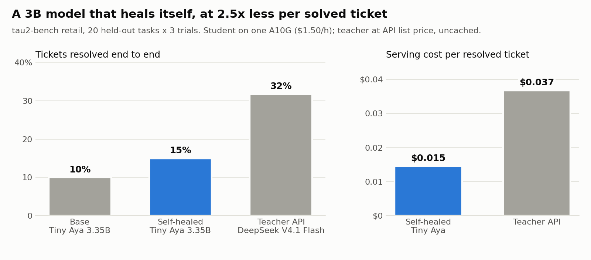
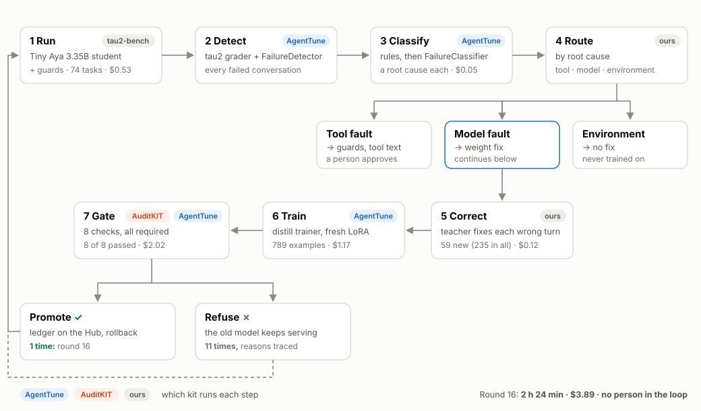
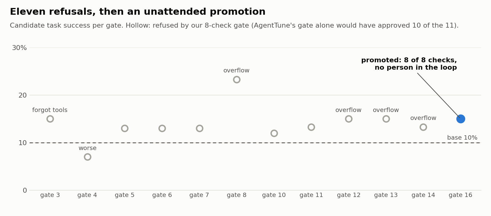
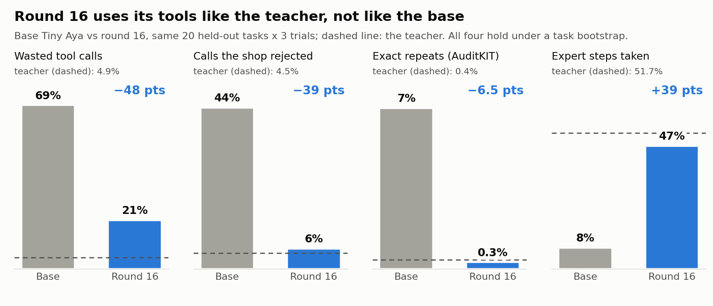

# Shipwright: a 3B support agent that fixes its own mistakes

**A 3.35B Tiny Aya support agent that fixes its own mistakes for $4 a round, and refused to ship itself 11 times until the fix was real. On its first unattended promotion, invented order ids fell 40 → 0, tool errors 44% → 6% and wasted tool calls 69% → 21%, and it now resolves retail tickets for $0.015 each, 2.5× less than the teacher API it learned from.**

*Shipwright, Lexsi Labs AI Safety & Alignment Hackathon, Track 3 (problem statement 8: self-healing agents).*

Most AI agents fail quietly. A support bot invents an order number, cancels the wrong thing, or loops until the customer gives up, and tomorrow it does the same again. The usual fix is a bigger model behind an API. We wanted the opposite: the **smallest** Aya model, **Tiny Aya Global (3.35B)**, on one cheap GPU, made better by a loop that finds its own failures, fixes them and only redeploys when the fix is measured.

On 15 November the loop did that end to end with no person in it. One command, a $4 spending cap, and 2 hours 24 minutes later a new adapter was trained, tested and promoted.

## The setup: base, student, teacher

- **Base:** Tiny Aya Global 3.35B, unchanged.
- **Student:** the same model plus a small LoRA adapter (about 30M parameters, under 1% of the model). This is what the loop trains and deploys, on one A10G GPU at $1.50 an hour.
- **Teacher:** DeepSeek V4.1 Flash. It shows the right behaviour and is never deployed.

The job is **tau2-bench retail**, a public benchmark: a simulated customer, 16 shop tools (look up orders, cancel, return, exchange, change addresses), a written policy, and a grader that checks whether the shop database ends up right, not whether the reply sounded right.

## The loop

1. **Run** the student on training tasks and log every turn, including the raw model output.
2. **Detect** failures: tau2's grader plus AgentTune's `FailureDetector`.
3. **Classify** each failure (rules first, then AgentTune's `FailureClassifier`) and **route** it: a tool problem gets a tool fix, a model problem gets a weight fix, and an environment problem (a buggy simulated customer) gets no fix and is never trained on.
4. **Correct:** the teacher replays failed tasks, and at every turn where the student went wrong it answers from the student's exact context.
5. **Train** a fresh adapter with AgentTune's `create_distill_trainer`.
6. **Gate:** base and candidate on 20 held-out tasks × 3 trials. Eight checks, all required: AuditKIT pass^1 and pass^k, targeted failures down, no new failure kind, BFCL (general tool use, to catch forgetting), and AgentTune's own `DeploymentGate`.
7. **Promote or keep the old one**, recorded in a ledger with rollback.

## A gate that says no

The gate refused 11 times before it said yes.

Each refusal had a reason we could trace: the first adapter forgot general tool calling (BFCL fell 43 → 35), later ones invented new failure kinds, and several overflowed Tiny Aya's 8,192-token window because the student kept working where the base gives up. AgentTune's own `DeploymentGate`, which only asks "is task success not worse?", would have approved ten of the eleven candidates ours refused. A loop that always approves its own updates isn't self-healing; it's retraining on a schedule.

## What the student stopped doing

Round 16 against the base, 60 conversations each:

| | Base | Self-healed |
|---|---|---|
| Invented an order or item id | 40 | **0** |
| Handed off to a human too early | 11 | **0** |
| Made up an answer | 8 | **0** |
| Tool-call error rate | 44% | **6%** |
| BFCL general tool calling | 45 | **73** |
| Tickets resolved end to end | 10% | **15%** |

## Round 16's biggest jump: it uses tools like the teacher

Pass rates on 20 tasks are noisy, so we added a metric that looks inside each conversation. tau2 stores the calls an expert agent makes for every task. We compare each conversation with that path and count the wasted calls (repeats of an earlier call with nothing changed in between, calls the shop rejected, and calls our runtime guards had to block) and the expert's steps the agent also took.

The base wastes 69% of its tool calls, mostly calls the shop rejects, and takes only 8% of the steps an expert would; it looks frugal only because it gives up early. Round 16 wastes 21%, and on three measures it is at the teacher's level: rejected calls 6% (teacher 4.5%), exact repeats 0.3% (teacher 0.4%), expert steps taken 47% (teacher 52%). All four changes hold under a task bootstrap, and the exact-repeat numbers come from AuditKIT's own `RedundantToolCalls`, not our code.

The reason is the most satisfying result of the project: round 16 trained on the teacher's fix for exactly the turns where the student went wrong, including every call our guards had blocked, so the guards' lessons moved into the weights. What it did not fix: a fifth of its calls are still wasted (teacher 5%), and its conversations run about twice as long as the teacher's. That is the next target.

## Why it matters for a business

Running the self-healed student instead of the teacher's API for first-line retail support costs about **$22 instead of $117 per 10,000 conversations**, or **$0.015 instead of $0.037 per resolved ticket**, and every conversation stays on hardware the shop controls. It resolves 15% of tickets end to end against the teacher's 32%, so today it is a first-line agent that never invents an order id and hands the rest to people. Each unattended round costs about $4.

## What didn't work, and what we would do next

- **The 8K window is the wall.** Tasks needing two or more changes stay unsolved; long conversations overflow. Compressing the history harder barely helped (15 → 13 overflowing runs offline); the overflow is a symptom of a stuck conversation, not its cause.
- **The student acts more, so it also errs more:** 13% of its conversations made a wrong change, against 3% for the base (which mostly gives up) and 10% for the teacher.
- **Small samples.** 3 extra passes in 60 is not significant on its own. Pooled over three gates, the round 7 adapter solved 17.2% vs 10% (13 paired wins, 0 losses), and 10% vs 0% on 20 hidden tasks opened once.
- **Next, with more credit:** the same loop on **Aya Expanse 32B** (128K context), with Tiny Aya kept as the cheap first tier; a k-fold gate over 94 tasks instead of 20; and a teacher bake-off, since a student rarely passes its teacher.

## Links

- Code and full write-up: GitHub (link at submission)
- Models: https://huggingface.co/collections/mitushigoyal5/shipwright-self-healing-tiny-aya-models-6af95bf1307f37a24ad807c6
- Data, every gate trace and decision: https://huggingface.co/collections/mitushigoyal5/shipwright-self-healing-tiny-aya-datasets-6af95bf29994d1dfbba71cbb

Built with Lexsi Labs' AgentTune and AuditKIT, Cohere Labs' Tiny Aya, and Sierra's tau2-bench.
